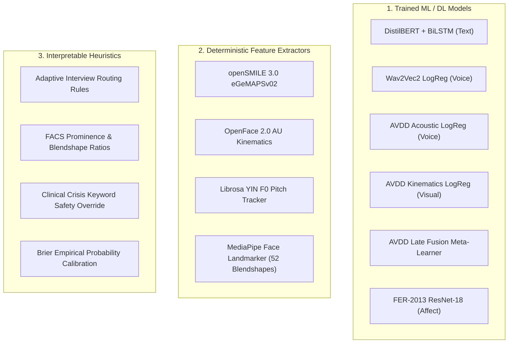

# NeuroScreen — Dataset Inventory & Model Provenance

**Document Version:** 1.0.0  
**Application URL:** `/doctor/datasets`  
**API Endpoint:** `GET /api/doctor/datasets`

---

## 1. Dataset Profiles

### 1.1 Emotional Audio and Text Dataset (EATD-Corpus)
- **Source:** Shen et al. (Chinese University Student Emotional Interview Corpus)
- **Format:** Audio recordings (WAV) + interview transcripts (Chinese/English translated)
- **Participants:** 162 total (109 control, 53 depressed)
- **Ground Truth:** Zung Self-rating Depression Scale (SDS standardized score $\ge 50$)
- **Partitions:** 72 test samples (24 held-out participants $\times 3$ prompts: positive, neutral, negative)
- **Quality Exclusion:** Participant 83 audio file is 0 bytes and strictly excluded.
- **Project Role:** Primary training corpus for text semantics and bilingual speech benchmarks.

### 1.2 Audio-Visual Depression Dataset — TCMI (AVDD-TCMI)
- **Source:** Zheng et al. (TCM Clinical Depression Multimodal Dataset)
- **Format:** openSMILE 88 acoustic CSVs + OpenFace AU kinematics CSVs + 25,830 facial crop JPGs
- **Participants:** 1,230 participants total across two distinct cohorts:
  - **Clinical Cohort (HDS):** 282 patients (123 depressed, 159 control, HDS $\ge 20$)
  - **Screening Cohort (SDS):** 948 university students (138 screening positive, 810 control)
- **Quality Exclusion:** No raw audio WAV or video MP4 provided. Frame count mismatch prevents row-level joining; multimodal fusion is performed at the decision/late-fusion layer.
- **Project Role:** Primary multimodal late-fusion and acoustic/kinematic benchmark.

### 1.3 Facial Expression Recognition 2013 (FER-2013)
- **Source:** Goodfellow et al. (ICML 2013 Challenge)
- **Format:** 35,887 grayscale $48\times 48$ face crops
- **Classes:** 7 discrete emotion categories (Angry, Disgust, Fear, Happy, Sad, Surprise, Neutral)
- **Partitions:** 28,709 train, 3,589 validation, 3,589 private test
- **Clinical Role:** **Strictly auxiliary affect classifier.** Surface facial expressions must never be conflated with psychiatric depression.

### 1.4 Harvard English Depression Tweets
- **Source:** Harvard Dataverse Mental Health Corpus
- **Format:** Excel spreadsheet (`.xlsx`, 4.68 MB)
- **Records:** 99,590 social media posts
- **Audit Finding:**
  - 21,996 rows contain corrupted `'xexx'` apostrophe artifacts.
  - No user/author identifiers exist (participant-level train/test separation impossible).
  - Inverted/ambiguous label legend in workbook documentation.
- **Status:** **Quarantined & blocked from supervised training** pending depositor confirmation.

### 1.5 Distress Analysis Interview Corpus — Wizard-of-Oz (DAIC-WOZ)
- **Source:** USC Institute for Creative Technologies / AVEC Challenge
- **Format:** 189 clinical video/audio interviews conducted by virtual interviewer Ellie
- **Ground Truth:** Patient Health Questionnaire 8-item (PHQ-8 score $\ge 10$)
- **Status:** **Access Pending Institutional DUA.** Official application drafted; pipeline components staged in `backend/app/daic_woz/`.

---

## 2. Model Taxonomy & Readiness Classification

