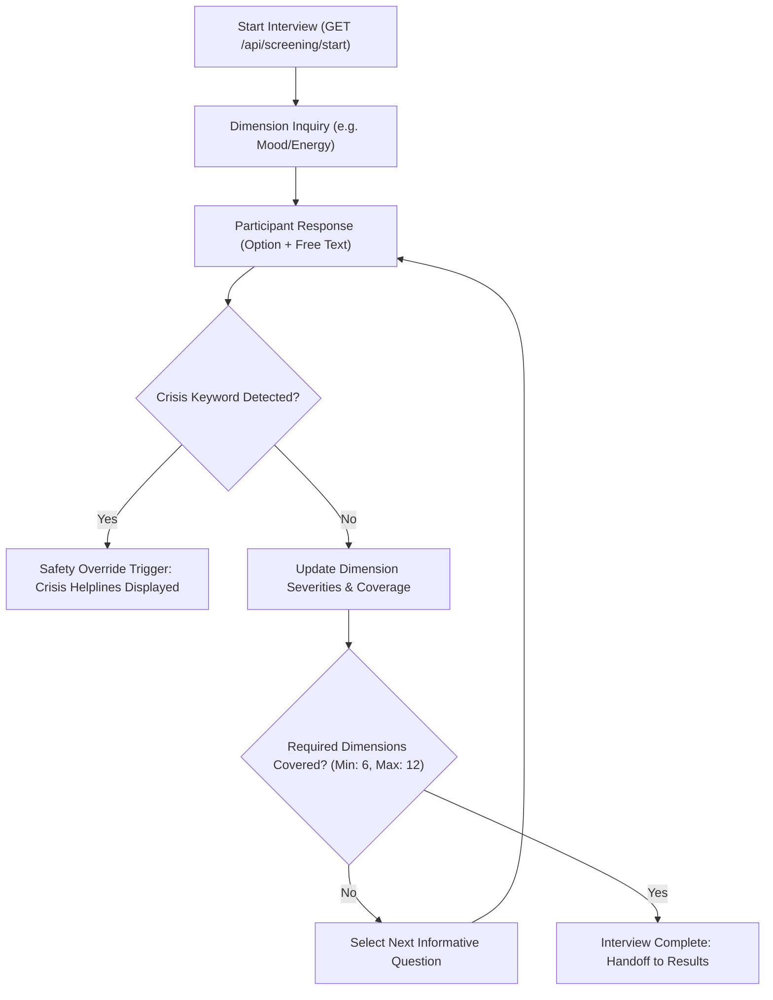

# NeuroScreen — Experimental Adaptive Research Questionnaire Design

**Document Version:** 1.0.0  
**Implementation:** `backend/app/services/adaptive_screener.py`, `frontend/components/screening/adaptive-interview.tsx`

---

## 1. Research Objective & Framing

The Adaptive Interview is an **investigational decision-support instrument** designed to systematically sample observations across 6 key clinical symptom dimensions without subjecting participants to rigid, exhausting 30-item batteries.

> [!NOTE]
> **Research Labeling Standard:**
> The questionnaire is labeled across all screens as:  
> *"Experimental Adaptive Research Questionnaire — intended for clinical research screening observation, not a diagnostic instrument."*

---

## 2. Six Core Symptom Dimensions

The screening engine tracks information coverage across 6 standardized DSM/PHQ symptom dimensions:

1. **Depressed Mood / Dysphoria:** Feelings of sadness, emptiness, hopelessness, or emotional numbness.
2. **Sleep Disruption:** Initial insomnia, frequent awakenings, early morning awakening, or excessive hypersomnia.
3. **Fatigue & Energy Loss:** Chronic physical exhaustion, low stamina, and lethargy disproportionate to physical exertion.
4. **Anhedonia / Loss of Interest:** Diminished pleasure or engagement in hobbies, social interactions, or routine activities.
5. **Concentration & Focus:** Difficulty sustaining attention, brain fog, executive dysfunction, and indecisiveness.
6. **Social Withdrawal & Isolation:** Avoidance of friends, family, and collaborative social environments.

---

## 3. Dynamic Adaptive Progression Logic

Instead of a fixed static list, follow-up questions dynamically target dimensions with high uncertainty or elevated severity:

### Controls & User Experience Enhancements
- **Pre-Interview Briefing:** Explains interview purpose, voluntary participation, and estimated duration (~3–5 minutes).
- **Adaptive Progress Indicator:** Never shows a misleading "Question 3 of 10"; instead displays questions answered, percentage progress, and minimum-to-maximum anticipated bounds.
- **Pause & Resume:** Allows participants to pause and resume their interview session without losing responses or session state.
- **Response Review Drawer:** Lets participants review all previously answered questions and selected options.
- **Option Selection + Free Text:** Provides radio option shortcuts with optional free-form text elaboration for linguistic model analysis.
