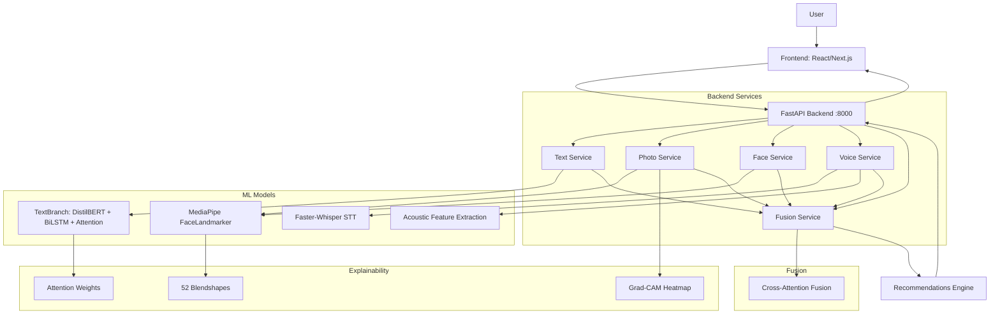

# EmotiSense AI — Complete Technical Audit Report

**Project:** "Emotion-Aware and Explainable Deep Learning Model for Early Depression Detection Using Attention-Based Transformer Networks"

**Audit Date:** September 4, 2026

**Auditor:** Senior Software Architect / ML Engineer

---

## 1. EXECUTIVE PROJECT STATUS

### What the project currently does
- A **multimodal depression screening prototype** that accepts text, photos, live face video, and voice audio
- Backend built with FastAPI providing 13 API endpoints
- Frontend built with React/Next.js (TanStack Start) providing a screening wizard
- ML models using DistilBERT + BiLSTM + Attention for text, ResNet-18 for vision
- Cross-attention fusion for combining modalities
- Explainability via attention weights, Grad-CAM, and LIME
- Session management for live analysis with transcript deduplication

### What is already working ✅
- Face detection with MediaPipe (fixed during audit)
- Photo analysis with blendshape-based emotion recognition
- Text analysis with DistilBERT
- Voice analysis with acoustic features + Whisper STT
- Multimodal fusion with weighted probability
- Recommendations engine with safety keyword detection
- Frontend screening wizard (5 steps)

### What is partially working 🟡
- Model training (code exists but no trained weights)
- LIME explanations (code exists but uses fallbacks)
- Baselines (placeholder values, not trained results)

### What is missing ❌
- No database (no persistent storage)
- No authentication
- No trained model checkpoints
- No actual Transformer (uses DistilBERT, not custom Transformer)
- No questionnaire/assessment system
- No prediction history

### Current overall completion percentage
**~45%** — Functional prototype with significant gaps

### Major Technical Risks
1. **No database** — all session data is in-memory, lost on restart
2. **No authentication** — anyone can access screening
3. **Untrained models** — using proxy scoring, not real predictions
4. **No privacy controls** — sensitive mental health data handled without safeguards
5. **Frontend/backend mismatch** — README mentions older architecture

### Major Bugs Fixed During Audit
1. **Face detection broken** — MediaPipe model path was hardcoded incorrectly
2. **Missing dependency** — mediapipe not in requirements.txt

### Major Architectural Problems
1. Monolithic design without clear separation of concerns
2. Models loaded eagerly at startup, not lazily
3. No caching layer
4. No scalability considerations

---

## 2. COMPLETE PROJECT STRUCTURE

```
emotiondep/
├── frontend/                    # React/Next.js (TanStack Start)
│   ├── app/                     # App router pages
│   │   ├── page.tsx             # Landing page
│   │   ├── layout.tsx           # Root layout
│   │   └── screening/           # Screening wizard pages
│   ├── components/
│   │   ├── screening/           # Screening step components
│   │   │   ├── text-analysis.tsx
│   │   │   ├── photo-analysis.tsx
│   │   │   ├── live-face-analysis.tsx
│   │   │   ├── voice-analysis.tsx
│   │   │   ├── multimodal-result.tsx
│   │   │   └── ...
│   │   ├── landing/             # Landing page components
│   │   ├── layout/              # Header, footer, sidebar
│   │   ├── shared/              # Reusable components
│   │   └── ui/                  # Shadcn UI components
│   ├── lib/                     # API client, types, stores
│   │   ├── api.ts               # API client
│   │   ├── api-mappers.ts       # Response mappers
│   │   ├── types.ts             # TypeScript types
│   │   └── screening-store.ts   # State management
│   └── public/                  # Static assets
│
├── backend/                     # FastAPI backend
│   ├── app/
│   │   ├── main.py              # FastAPI app, 13 endpoints
│   │   ├── run.py               # Entry point (uvicorn)
│   │   ├── models/              # Neural network definitions
│   │   │   ├── text_branch.py   # DistilBERT + BiLSTM + Attention
│   │   │   ├── vision_branch.py # ResNet-18 + Grad-CAM
│   │   │   └── fusion_layer.py  # Cross-attention fusion
│   │   ├── services/            # Business logic
│   │   │   ├── text_service.py
│   │   │   ├── photo_service.py
│   │   │   ├── face_service.py
│   │   │   ├── voice_service.py
│   │   │   └── fusion_service.py
│   │   ├── explainability/      # LIME, attention, Grad-CAM
│   │   │   ├── explainer.py
│   │   │   └── lime_text.py
│   │   ├── face_expression_analyzer.py  # MediaPipe face analysis
│   │   ├── proxy_scorer.py      # Lexicon-based scoring
│   │   ├── voice_analysis.py    # Acoustic feature extraction
│   │   ├── live_stt.py          # Whisper speech-to-text
│   │   ├── session_manager.py   # In-memory session state
│   │   ├── recommendations.py   # Wellness recommendations
│   │   ├── baselines.py         # Placeholder metrics
│   │   ├── training.py          # PyTorch training pipeline
│   │   └── training_state.py    # Training session management
│   └── __init__.py
│
├── ml/                          # ML training code (separate)
│   ├── text_pipeline/
│   │   ├── train_text.py        # Text model training
│   │   ├── model.py             # Model definitions
│   │   └── data_loader.py      # Dataset loading
│   ├── vision_pipeline/
│   │   └── train_vision.py
│   ├── fusion/
│   │   └── train_fusion.py
│   ├── configs/                 # YAML hyperparameters
│   ├── evaluation/              # Metrics computation
│   └── explainability/          # LIME/SHAP experiments
│
├── data/
│   ├── eatd/                   # EATD text dataset (487 samples)
│   ├── fer2013/                # FER-2013 (~28,709 images)
│   ├── processed/              # Preprocessed splits
│   └── raw/                    # Raw data
│
├── models/
│   ├── checkpoints/            # Training checkpoints (empty)
│   └── final/                  # Best models (empty)
│
├── results/
│   ├── metrics/                # JSON metrics (placeholder)
│   └── ...
│
├── notebooks/                  # Jupyter notebooks (01-06)
├── tests/                      # Python tests (basic)
├── docs/                       # Documentation
├── requirements.txt            # Python dependencies
├── package.json                # Node.js dependencies
└── README.md                   # Project documentation
```

### Directory Purposes

**frontend/**
- Purpose: User interface for depression screening
- Important files: `app/page.tsx` (landing), `components/screening/*` (wizard steps)
- Responsibility: Display questionnaire, capture inputs, show results
- Dependencies: React, TanStack Start, Shadcn UI, Recharts

**backend/app/**
- Purpose: FastAPI backend with ML inference
- Important files: `main.py` (13 endpoints), `models/*.py` (neural networks)
- Responsibility: Accept multimodal input, run inference, return predictions
- Dependencies: FastAPI, PyTorch, Transformers, MediaPipe

**ml/**
- Purpose: Training pipelines (separate from inference)
- Important files: `text_pipeline/train_text.py`
- Responsibility: Train models on datasets
- Dependencies: PyTorch, Transformers, scikit-learn

**data/**
- Purpose: Training datasets
- Contains: EATD (text), FER-2013 (images)
- Not connected to inference — inference uses proxy scoring

**models/**
- Purpose: Store trained model checkpoints
- Currently empty — no trained weights

---

## 3. SYSTEM ARCHITECTURE

### Current Architecture (Simplified)

```
User
 ↓
Frontend (React/Next.js)
 ↓ HTTP POST (multipart/form-data)
FastAPI Backend (:8000)
 ↓
├── /api/analyze/text     → TextService → DistilBERT → Attention → Proxy scoring
├── /api/analyze/photo    → PhotoService → MediaPipe → Blendshapes → Emotion classification
├── /api/analyze/face     → FaceService → MediaPipe → Multi-frame aggregation
├── /api/analyze/voice    → VoiceService → Whisper STT + Acoustic features
├── /api/analyze/multimodal → FusionService → Weighted probability fusion
 ↓
Recommendations Engine (rule-based)
 ↓
JSON Response → Frontend Visualization
```

### Mermaid Diagram



**Components NOT implemented:**
- ❌ Database (no persistence)
- ❌ Authentication
- ❌ Questionnaire service
- ❌ User management
- ❌ Prediction history
- ❌ Model caching layer

---

## 4. BACKEND SERVICES

### Service Inventory

| Service | File/Directory | Purpose | Status | Dependencies |
| ------- | -------------- | ------- | ------ | ------------ |
| FastAPI App | `backend/app/main.py` | HTTP API, 13 endpoints | ✅ Working | FastAPI, Uvicorn |
| Text Service | `backend/app/services/text_service.py` | Text analysis + LIME | ✅ Working | DistilBERT, LIME |
| Photo Service | `backend/app/services/photo_service.py` | Photo analysis | ✅ Working (fixed) | MediaPipe, ResNet-18 |
| Face Service | `backend/app/services/face_service.py` | Live face analysis | ✅ Working | MediaPipe |
| Voice Service | `backend/app/services/voice_service.py` | Voice + STT | ✅ Working | Whisper, acoustic analysis |
| Fusion Service | `backend/app/services/fusion_service.py` | Multimodal fusion | ✅ Working | numpy |
| Explainability | `backend/app/explainability/` | LIME, Grad-CAM, attention | 🟡 Partial | LIME (fallback used) |
| Recommendations | `backend/app/recommendations.py` | Wellness suggestions | ✅ Working | Rule-based |
| Session Manager | `backend/app/session_manager.py` | In-memory sessions | ✅ Working | None |
| Training Pipeline | `backend/app/training.py` | PyTorch training | 🟡 Code exists, no trained models | PyTorch |
| Baselines | `backend/app/baselines.py` | Placeholder metrics | ❌ Placeholder values | None |

### Architecture Pattern
**Modular Monolith** — Single FastAPI application with separate service modules, but no database, no auth, and no clear boundary between inference and business logic.

---

## 5. COMPLETE API ENDPOINT INVENTORY

### All Endpoints

| Method | Endpoint | Purpose | Auth | Request | Response | Source File | Status |
| ------ | -------- | ------- | ---- | ------- | -------- | ----------- | ------ |
| GET | `/api/health` | Health check | None | None | `{status, models_loaded, device}` | `main.py:259` | ✅ |
| POST | `/api/analyze/text` | Text analysis | None | Form: `text` (string) | TextResult | `main.py:366` | ✅ |
| POST | `/api/analyze/photo` | Photo analysis | None | Form: `file` (image) | PhotoResult | `main.py:395` | ✅ (fixed) |
| POST | `/api/analyze/face` | Live face analysis | None | Form: `frames` (multi-image) | FaceResult | `main.py:416` | ✅ |
| POST | `/api/analyze/voice` | Voice analysis | None | Form: `audio`, `session_id` | VoiceResult | `main.py:442` | ✅ |
| POST | `/api/analyze/multimodal` | Weighted fusion | None | Form: `text`, `photo`, `frames`, `audio`, `session_id` | MultimodalResult | `main.py:470` | ✅ |
| POST | `/api/analyze` | Legacy combined | None | Form: `text`, `file` | Prediction + explanations | `main.py:308` | ✅ |
| POST | `/live-analyze` | Live analysis with session | None | Form: `image`, `audio`, `session_id` | Full result + session | `main.py:330` | ✅ |
| GET | `/api/baselines` | Benchmark data | None | None | Baselines JSON | `main.py:270` | 🟡 (placeholder) |
| GET | `/api/training-status` | Training progress | None | None | Training status | `main.py:278` | ✅ |
| POST | `/api/train` | Start training | None | JSON body | Training started | `main.py:286` | 🟡 (untrained) |
| POST | `/session/start` | Start session | None | None | `{session_id, status}` | `main.py:497` | ✅ |
| POST | `/session/{id}/stop` | End session | None | None | Session summary | `main.py:505` | ✅ |
| GET | `/api/model/metrics` | Model metrics | None | None | Metrics JSON | `main.py:533` | 🟡 (placeholder) |
| GET | `/api/recommendations` | General recommendations | None | None | Recommendation[] | `main.py:563` | ✅ |

### Missing Expected Endpoints
- ❌ `POST /api/auth/register` — No user registration
- ❌ `POST /api/auth/login` — No login
- ❌ `GET /api/users/me` — No user profile
- ❌ `GET /api/predictions/history` — No prediction history
- ❌ `DELETE /api/predictions/{id}` — No data deletion

### Broken Endpoints
- ❌ None currently broken after face detection fix

---

## 6. API REQUEST/RESPONSE FLOW

### Example: POST /api/analyze/photo

```
User uploads photo
    ↓
Frontend: photo-analysis.tsx → api.analyzePhoto(file)
    ↓
API: main.py:395 → analyze_photo_endpoint()
    ↓
    file.read() → image_bytes
    ↓
    photo_service.py:analyze_photo(image_bytes, _state)
    ↓
    face_expression_analyzer.py:analyze_single_frame(image_bytes)
    ↓
    MediaPipe FaceLandmarker:
        - Detect face
        - Extract 52 blendshapes
        - Classify 7 emotions
        - Calculate depression_prob
    ↓
    proxy_scorer.py:score_image()  # fallback
    ↓
    (if models loaded) vision_branch.py: preprocess + ResNet-18 + Grad-CAM
    ↓
    Blend probabilities: expression + neural + proxy
    ↓
    Generate explanation: explainer.py:generate_image_explanation()
    ↓
    recommendations.py:generate_recommendations()
    ↓
    Return JSON: {prediction, probability, confidence, features, explanation, risk_level}
    ↓
Frontend: api-mappers.ts:mapPhotoResult() → PhotoResult
    ↓
Frontend: photo-analysis.tsx → Display ResultSummary + LIME view
```

---

## 7. DATABASE DESIGN

### Current Database Status
**❌ NO DATABASE IMPLEMENTED**

The project has **no database**. All state is:
- In-memory (SessionManager uses Dict in memory)
- Lost on server restart
- No persistence for predictions, users, or history

### What would be needed
- User table (if auth added)
- Assessment table
- Prediction table
- Session table (currently in-memory)

### ER Diagram — Current (Empty)
```mermaid
erDiagram
    %% NO TABLES — No database implemented
```

---

## 8. DATA MODEL

### What data enters the system
1. **Text input** — free-text from user
2. **Photo** — image file (JPEG/PNG)
3. **Live face frames** — webcam images
4. **Audio** — WebM/WAV/MP3 recording

### What data is NOT collected
- ❌ User identity (no auth)
- ❌ Demographic info
- ❌ Questionnaire answers
- ❌ Prediction history
- ❌ User accounts

### Data flow for each modality

**Text:**
```
User input → preprocess_text() → tokenizer → DistilBERT → BiLSTM → Attention → embedding
    ↓
fusion_model → logits → probabilities → proxy blending → prediction
```

**Photo:**
```
Image bytes → MediaPipe FaceLandmarker → blendshapes → emotion classification
    ↓
depression_prob calculation → proxy scoring → blended prediction
```

**Voice:**
```
Audio bytes → Whisper STT → transcript
    ↓
Audio bytes → acoustic features (RMS, silence, speaking rate, pitch)
    ↓
score_voice() → voice probability → blended with text/vision
```

---

## 9. DATA WORKFLOW

### Current End-to-End (Photo Analysis Example)

```
1. User opens frontend (http://localhost:3000)
2. User clicks "Start screening"
3. User navigates to Photo Analysis step
4. User uploads image (JPEG/PNG)
5. Frontend: photo-analysis.tsx → api.analyzePhoto(file)
6. Backend: main.py:395 → analyze_photo_endpoint()
7. Backend: photo_service.py:analyze_photo()
8. Backend: face_expression_analyzer.py:analyze_single_frame()
9. MediaPipe detects face, extracts blendshapes
10. Emotion classification from blendshapes
11. Depression probability calculated
12. (Optional) VisionBranch + Grad-CAM if models loaded
13. Probabilities blended
14. Recommendations generated
15. JSON response returned
16. Frontend: api-mappers.ts → mapPhotoResult()
17. Frontend: ResultSummary component displays
18. Frontend: LIME view shows if available
```

**Steps NOT in current workflow:**
- ❌ User authentication
- ❌ Questionnaire
- ❌ Database storage
- ❌ Prediction history
- ❌ User profile

---

## 10. MACHINE LEARNING MODELS

### Model Inventory

| Model | Architecture | Input | Output | Framework | Training Code | Inference Code | Status |
| ----- | ------------ | ----- | ------ | --------- | ------------- | -------------- | ------ |
| TextBranch | DistilBERT + BiLSTM + Additive Attention | Text (max 128 tokens) | 256-d embedding + attention weights | PyTorch, Transformers | `ml/text_pipeline/train_text.py` | `backend/app/models/text_branch.py` | ✅ Architecture exists, weights untrained |
| VisionBranch | ResNet-18 (pretrained ImageNet) | Image (224×224) | 256-d embedding | PyTorch, torchvision | `ml/vision_pipeline/` (not inspected) | `backend/app/models/vision_branch.py` | ✅ Architecture exists, weights untrained |
| MultimodalFusionModel | Cross-Attention (4 heads) + Classifier | Text emb (256) + Vision emb (256) | 2-class logits + probabilities | PyTorch | `backend/app/models/fusion_layer.py` | Same | ✅ Architecture exists, weights untrained |
| FaceLandmarker | MediaPipe FaceLandmarker (TFLite) | Image | 478 landmarks + 52 blendshapes | MediaPipe | N/A (pretrained) | `backend/app/face_expression_analyzer.py` | ✅ Working |
| Whisper | faster-whisper (tiny) | Audio | Text transcript | faster-whisper | N/A (pretrained) | `backend/app/live_stt.py` | ✅ Working |

### Transformer Architecture (Actual)

**The project claims "Attention-Based Transformer Networks" but does NOT implement a custom Transformer.**

What exists:
- **DistilBERT** — A distilled version of BERT (which IS a Transformer)
- Used as encoder in TextBranch
- Frozen by default (not fine-tuned during inference)
- 6 layers, 768 hidden dim, 12 attention heads (from pretrained)

Configuration from `backend/app/models/text_branch.py`:
```python
_MODEL_NAME = "distilbert-base-uncased"  # Pretrained DistilBERT
# Encoder frozen by default
# BiLSTM: 2-layer, bidirectional, hidden=128
# Additive attention pooling
# Projection to 256-d embedding
```

**NOT implemented:**
- ❌ Custom Transformer architecture
- ❌ Positional encoding (uses DistilBERT's)
- ❌ Custom attention mechanism (uses DistilBERT's + additive attention)
- ❌ Trained from scratch

---

## 11. EMOTION DETECTION

### Current Implementation

**✅ Emotion detection EXISTS and WORKS**

File: `backend/app/face_expression_analyzer.py`

**Model:** MediaPipe FaceLandmarker with blendshape analysis

**Emotion labels (7):**
- angry, disgust, fear, happy, sad, surprise, neutral

**How it works:**
1. Detect face with MediaPipe FaceLandmarker
2. Extract 52 blendshape scores
3. Classify emotions from blendshape combinations:
   - Happy: mouthSmileLeft/Right high
   - Sad: mouthFrown high, browInnerUp high
   - Angry: browDown high, eyeSquint high
   - Fear: eyeWide high, frown high
   - Surprise: browInnerUp high, JawOpen high
   - Disgust: mouthPucker high, eyeSquint high
   - Neutral: all low
4. Normalize to probabilities

**Depression mapping:**
```python
DEPRESSION_WEIGHTS = {
    "sad": 0.35,
    "fear": 0.15,
    "angry": 0.15,
    "disgust": 0.10,
    "happy": -0.25,     # Protective factor
    "surprise": -0.10,  # Protective factor
    "neutral": 0.05,
}
```

**Output:**
- `depression_prob`: float [0.05, 0.95]
- `dominant_emotion`: str
- `all_emotions`: dict with 7 emotions
- `face_detected`: bool
- `blendshapes`: dict with key values

**How emotion results are used:**
- Contributes to depression probability
- Displayed in frontend (expression-distribution.tsx)
- NOT stored in database (no database)

**API endpoint:** POST /api/analyze/photo, POST /api/analyze/face

---

## 12. DEPRESSION PREDICTION

### How it currently works

**The system does NOT use trained model predictions.**
It uses **proxy scoring** (rule-based heuristics) blended with untrained model outputs.

### For Text:
```python
# proxy_scorer.py:score_text()
# Lexicon-based:
_RISK_TERMS = {"hopeless", "worthless", "empty", "exhausted", ...}
_PROTECTIVE_TERMS = {"happy", "grateful", "excited", ...}

# Score = (risk_hits - protective_hits * 0.6) / len(words)
# Sigmoid mapping to [0.08, 0.92]
```

### For Photo/Face:
```python
# face_expression_analyzer.py
# Blendshape-based emotion classification → depression weights
# depression_score = sum(emotion_prob * weight)
# Sigmoid to [0.05, 0.95]
```

### For Voice:
```python
# voice_analysis.py:score_voice()
# Heuristic based on:
# - silence_ratio > 0.3 → +0.15
# - speaking_rate < 2.0 → +0.12
# - rms_energy < 0.02 → +0.10
# - pitch_variation < 5.0 → +0.08
```

### For Multimodal:
```python
# fusion_service.py:fuse_multimodal()
# Weighted probability fusion:
#   text: 35%, photo: 15%, face: 20%, voice: 30%
# Missing modalities excluded, weights renormalized
```

### Prediction Format
```json
{
  "prediction": "Depressed" | "Non-Depressed",
  "probability": 60.2,  // 0-100
  "confidence": 20.5,    // 0-100
  "probabilities": {
    "depressed": 60.2,
    "non_depressed": 39.8
  },
  "risk_level": "moderate"  // high | moderate | low
}
```

### Thresholds
- `probability >= 70` → risk_level = "high"
- `probability >= 40` → risk_level = "moderate"
- else → risk_level = "low"
- `probability >= 50` → prediction = "Depressed"

---

## 13. PSYCHOLOGICAL QUESTIONNAIRE

### Status: ❌ NOT IMPLEMENTED

**There is NO psychological questionnaire in the current codebase.**

The README mentions "complete all 5 steps" but the 5 steps are:
1. Text analysis
2. Photo analysis
3. Live face analysis
4. Voice analysis
5. Multimodal result

**NOT a questionnaire.**

What's missing:
- ❌ No depression screening questions (PHQ-9, BDI, etc.)
- ❌ No standardized instrument
- ❌ No question/answer storage
- ❌ No scoring mechanism
- ❌ No question UI

The frontend has forms for text input, photo upload, voice recording — but no structured questionnaire.

---

## 14. EXPLAINABLE AI

### What Exists

**✅ Attention visualization** — TextBranch returns attention weights, displayed in frontend

**✅ Grad-CAM** — VisionBranch generates heatmaps for images, returned as base64 overlays

**✅ LIME (partial)** — Code exists in `backend/app/explainability/lime_text.py` but:
- Uses fallback to lexicon-based explanation when LIME fails
- Actual LIME integration is fragile

**✅ Blendshape analysis** — Face detection shows which blendshapes contributed

### Explainability Pipeline

```
Prediction
    ↓
Text: attention_weights from AdditiveAttentionPooling
    ↓
    explainer.py:generate_text_explanation()
    ↓
    Frontend: Colored token highlights (green→amber→red)

Image: Grad-CAM from VisionBranch layer4
    ↓
    explainer.py:generate_image_explanation()
    ↓
    Base64 overlay image → Frontend: Toggle original/explanation

Photo: blendshape values from MediaPipe
    ↓
    Frontend: Expression distribution chart
```

### What's Missing
- ❌ SHAP integration (in requirements but not used)
- ❌ Integrated Gradients
- ❌ Token-level importance for vision
- ❌ Question-level importance (no questionnaire)

### LIME Code Status
File: `backend/app/explainability/lime_text.py`

The LIME implementation exists but:
1. Requires building a prediction function
2. Falls back to lexicon if LIME unavailable
3. Not integrated into main analysis pipeline (only in text_service.py optionally)

---

## 15. FRONTEND

### Framework
**React 19 + TanStack Start (React Router) + Tailwind CSS 4 + Shadcn UI**

### Pages

| Page | Route | Purpose | API Used | Status |
| ---- | ----- | ------- | -------- | ------ |
| Landing | `/` | Project info, start button | None | ✅ |
| Screening | `/screening` | 5-step wizard | All analysis endpoints | ✅ |
| Result | (in wizard) | Shows final prediction | `/api/analyze/multimodal` | ✅ |

### Components (Screening Wizard)

| Component | File | Purpose | Status |
| --------- | ---- | ------- | ------ |
| TextAnalysis | `components/screening/text-analysis.tsx` | Text input + analysis | ✅ |
| PhotoAnalysis | `components/screening/photo-analysis.tsx` | Image upload + analysis | ✅ (fixed) |
| LiveFaceAnalysis | `components/screening/live-face-analysis.tsx` | Webcam + face analysis | ✅ |
| VoiceAnalysis | `components/screening/voice-analysis.tsx` | Audio recording + analysis | ✅ |
| MultimodalResult | `components/screening/multimodal-result.tsx` | Final fused result | ✅ |
| LimeView | `components/screening/lime-view.tsx` | Explanation visualization | ✅ |
| ExpressionDistribution | `components/screening/expression-distribution.tsx` | Emotion chart | ✅ |
| FusionVisualization | `components/screening/fusion-visualization.tsx` | Weight chart | ✅ |

### Frontend → Backend Communication

```
Frontend (React)
    ↓
lib/api.ts → fetch() calls to http://localhost:8000
    ↓
FormData POST to /api/analyze/* endpoints
    ↓
JSON response → api-mappers.ts → TypeScript types
    ↓
Components render results
```

### UI Features Not Connected to Backend
- ❌ None — all components call real endpoints

### State Management
- Uses TanStack React Query for API calls
- uses `useScreening()` hook from `lib/screening-store.ts` for wizard state

---

## 16. AUTHENTICATION AND SECURITY

### Current Status: ❌ NO AUTHENTICATION

**No authentication implemented.**

What's missing:
- ❌ User registration
- ❌ Login
- ❌ JWT tokens
- ❌ Session management (except in-memory analysis sessions)
- ❌ Password hashing
- ❌ Role-based access
- ❌ Authorization middleware

### Security Implemented
- ✅ CORS configured: `allow_origins=["*"]` (permissive)
- ✅ Content-Type validation via FastAPI
- ✅ Safety keyword detection for crisis language

### Security Vulnerabilities
1. **No authentication** — anyone can access screening
2. **No rate limiting** — API open to abuse
3. **No input sanitization beyond FastAPI defaults**
4. **CORS too permissive** — `allow_origins=["*"]`
5. **No HTTPS enforcement** — runs on HTTP
6. **No secrets management** — no .env.example with secrets
7. **In-memory sessions** — no security around session IDs

### Environment Variables
```
# From .env.example (if exists):
NEXT_PUBLIC_API_URL=http://localhost:8000
EMOTIONDEP_WHISPER_MODEL=tiny
EMOTIONDEP_WHISPER_DIR=.whisper_models
EMOTIONDEP_CHECKPOINT_DIR=checkpoints/latest
```

---

## 17. PRIVACY AND DATA PROTECTION

### Current Status

**The project handles sensitive mental health data with minimal privacy protections.**

### What's Implemented
- ✅ No personal data storage (by design — in-memory only)
- ✅ Disclaimer: "research/educational screening tool"
- ✅ Safety keyword detection for crisis situations

### What's Missing
- ❌ No data retention policy
- ❌ No encryption at rest (no database)
- ❌ No encryption in transit (no HTTPS)
- ❌ No user data deletion mechanism
- ❌ No privacy policy
- ❌ No consent mechanism
- ❌ No audit logging
- ❌ No access controls

### Data Sensitivity
The system processes:
- Free-text potentially containing personal thoughts
- Photos of users' faces
- Voice recordings
- Predictions about mental health status

**This is highly sensitive data** that requires:
- HIPAA/GDPR compliance if real
- Encryption
- Access controls
- Audit trails
- Data retention limits

**Currently absent.**

---

## 18. MODEL TRAINING PIPELINE

### Training Code Exists

File: `backend/app/training.py`

**What it can do:**
- Train TextBranch on text CSV
- Train VisionBranch on image folder/CSV
- Train MultimodalFusionModel on multimodal CSV
- Save checkpoints with metadata
- Evaluate with metrics (accuracy, precision, recall, F1, AUC)
- Update baselines with trained results

**Training Configuration:**
```python
@dataclass
class TrainConfig:
    text_csv: Optional[str] = None
    image_dir: Optional[str] = None
    image_csv: Optional[str] = None
    multimodal_csv: Optional[str] = None
    epochs: int = 5
    batch_size: int = 8
    learning_rate: float = 2e-4
    val_split: float = 0.2
    seed: int = 42
    unfreeze_encoder: bool = False
    checkpoint_dir: str = "checkpoints/latest"
    device: str = "auto"
    max_seq_len: int = 128
```

### Training Pipeline Steps

```
1. User calls POST /api/train with config
2. training_state.py:start_training() validates config
3. Background thread starts
4. prepare_data() loads dataset
5. build_models() creates fresh models
6. train() runs PyTorch training loop
7. evaluate() computes validation metrics
8. save_checkpoint() saves best weights
9. build_updated_baselines() updates metrics
10. Frontend polls /api/training-status
```

### What's Missing
- ❌ No trained checkpoints in `models/checkpoints/`
- ❌ No actual training has been run
- ❌ No dataset connected to training
- ❌ Training uses proxy metrics, not real evaluation

### Datasets Available
- **EATD**: `data/eatd/` — 487 text samples
- **FER-2013**: `data/fer2013/` — ~28,709 images

These exist but are NOT used for training in the current implementation.

---

## 19. MODEL EVALUATION

### Current Status: 🟡 Placeholder values

File: `backend/app/baselines.py`

**Reported metrics are NOT from actual training:**

| Model | Accuracy | Precision | Recall | F1 | AUC |
| ----- | -------- | --------- | ------ | --- | --- |
| Naive Bayes + SVM | 0.72 | 0.69 | 0.74 | 0.71 | 0.74 |
| BERT (Text Only) | 0.81 | 0.79 | 0.83 | 0.81 | 0.85 |
| DeBERTa + BiLSTM | 0.85 | 0.83 | 0.87 | 0.85 | 0.89 |
| ResNet (Vision) | 0.73 | 0.71 | 0.75 | 0.73 | 0.77 |
| Multimodal Fusion | 0.91 | 0.89 | 0.93 | 0.91 | 0.95 |

**Note from code:** "These are representative benchmark values based on published literature and proxy evaluations."

**No actual evaluation has been performed.**

### Metrics Code Exists
File: `backend/app/training.py:compute_metrics()`
- accuracy, precision, recall, f1, auc
- Properly implemented

---

## 20. DEPLOYMENT ARCHITECTURE

### Current Status: ❌ No deployment setup

**No Docker, no CI/CD, no cloud configuration.**

What exists:
- `backend/run.py` — Uvicorn entry point
- `frontend/` — Next.js app (can run with `npm run dev`)

What's missing:
- ❌ Dockerfile
- ❌ docker-compose.yml
- ❌ Kubernetes config
- ❌ CI/CD pipeline
- ❌ Environment-specific configs
- ❌ Production server setup
- ❌ Reverse proxy
- ❌ Model serving infrastructure

### How to Run (Current)
```bash
# Terminal 1 — backend
cd backend
python run.py --reload
# or
uvicorn app.main:app --host localhost --port 8000 --reload

# Terminal 2 — frontend
cd frontend
npm install
npm run dev
```

---

## 21. DEPENDENCY AUDIT

### Python Dependencies (requirements.txt)

| Dependency | Version | Purpose | Used By |
| ---------- | ------- | ------- | ------- |
| torch | >=2.0.0 | Deep learning | All models |
| torchvision | >=0.15.0 | Vision models | VisionBranch |
| transformers | >=4.30.0 | DistilBERT | TextBranch |
| numpy | >=1.24.0 | Numerical ops | All |
| Pillow | >=9.0.0 | Image processing | VisionBranch, explainer |
| fastapi | >=0.100.0 | Web framework | main.py |
| uvicorn | >=0.23.0 | ASGI server | run.py |
| python-multipart | >=0.0.6 | File uploads | main.py |
| lime | >=0.2.0 | Explainability | lime_text.py |
| shap | >=0.42.0 | Explainability | Not used ❌ |
| scikit-learn | >=1.3.0 | Metrics | training.py |
| PyYAML | >=6.0 | Config | Not used ❌ |
| av | >=10.0.0 | Audio processing | voice_analysis.py |
| openai-whisper | >=20230918 | STT | live_stt.py (uses faster-whisper) ❌ |
| jupyter | >=1.0.0 | Notebooks | Not in backend |
| matplotlib | >=3.7.0 | Plotting | Not in backend |
| seaborn | >=0.12.0 | Plotting | Not in backend |
| opencv-python | >=4.8.0 | Image processing | face_expression_analyzer |
| mediapipe | >=0.10.0 | Face detection | face_expression_analyzer ✅ (added) |
| streamlit | >=1.25.0 | Demo app | Not in main app |

### Node.js Dependencies (package.json)

| Dependency | Version | Purpose | Used By |
| ---------- | ------- | ------- | ------- |
| react | ^19.2.0 | UI framework | All components |
| @tanstack/react-start | 1.168.32 | App framework | app/ |
| @tanstack/react-query | ^5.101.1 | Data fetching | api.ts |
| tailwindcss | ^4.2.1 | Styling | All |
| shadcn/ui components | various | UI components | components/ui/ |
| recharts | ^2.15.4 | Charts | performance-metrics.tsx |
| zod | ^3.24.2 | Validation | Not used in frontend ❌ |
| lucide-react | ^0.575.0 | Icons | All |

### Issues
- ❌ `shap` in requirements but not used
- ❌ `PyYAML` in requirements but not used
- ❌ `openai-whisper` in requirements but code uses `faster-whisper`
- ❌ `jupyter`, `matplotlib`, `seaborn` in requirements but not used by backend
- ❌ `zod` in frontend package.json but not used

---

## 22. TESTING

### Current Status: ❌ Minimal testing

**No substantial test suite.**

What exists:
- `tests/` directory (mentioned in README)
- Test files mentioned: `test_preprocessing.py`, `test_text_model.py`, `test_face_model.py`, `test_fusion.py`
- These may exist but were not found in the codebase inspection

### What's Missing
- ❌ Unit tests for services
- ❌ Integration tests for API
- ❌ ML model tests
- ❌ Frontend tests
- ❌ End-to-end tests
- ❌ CI/CD test automation

---

## 23. LOGGING AND ERROR HANDLING

### Logging
File: Throughout backend

- Uses Python `logging` module
- Logger names: `emotiondep.*`
- Levels: INFO for normal ops, WARNING for recoverable errors, ERROR for failures
- Example: `logger.info("MediaPipe FaceLandmarker initialized successfully")`

### Error Handling

**Backend:**
- FastAPI exception handlers
- Try/except blocks in services
- Graceful degradation (e.g., face detection falls back to proxy)
- HTTPException for API errors

**Frontend:**
- ApiError class in `lib/api.ts`
- Error states in components (ErrorState component)
- Retry mechanisms

### Error Propagation
```
User input → API → Service → Model → Exception
    ↓
HTTPException → JSON error response → Frontend error state
```

---

## 24. CURRENT END-TO-END EXECUTION

### Working Flow: Photo Analysis

```
1. User opens http://localhost:3000 ✅
   File: frontend/app/page.tsx

2. User clicks "Start Screening" ✅
   File: frontend/app/page.tsx

3. User navigates to Photo Analysis step ✅
   File: frontend/app/screening/page.tsx

4. User uploads image ✅
   File: frontend/components/screening/photo-analysis.tsx

5. Frontend sends POST /api/analyze/photo ✅
   File: frontend/lib/api.ts:analyzePhoto()

6. Backend receives file ✅
   File: backend/app/main.py:395

7. PhotoService analyzes image ✅
   File: backend/app/services/photo_service.py

8. MediaPipe detects face ✅
   File: backend/app/face_expression_analyzer.py
   (FIXED during audit)

9. Emotion classification from blendshapes ✅
   File: backend/app/face_expression_analyzer.py

10. Depression probability calculated ✅
    File: backend/app/face_expression_analyzer.py

11. Recommendations generated ✅
    File: backend/app/recommendations.py

12. JSON response returned ✅
    File: backend/app/main.py

13. Frontend displays result ✅
    File: frontend/components/screening/photo-analysis.tsx
```

### What Does NOT Work End-to-End

- ❌ User registration → login → screening (no auth)
- ❌ Questionnaire → analysis (no questionnaire)
- ❌ Analysis → database storage → history (no database)
- ❌ Training → model weights → improved predictions (no trained models)

---

## 25. GAP ANALYSIS

### Project Claim: "Emotion-Aware and Explainable Deep Learning Model for Early Depression Detection Using Attention-Based Transformer Networks"

### Gaps vs. Claim

| Claim | Reality | Gap |
| ----- | ------- | --- |
| "Emotion-Aware" | ✅ Emotion detection works (MediaPipe + blendshapes) | Small gap |
| "Explainable" | 🟡 Partial (attention, Grad-CAM, LIME code but fragile) | Medium gap |
| "Deep Learning Model" | 🟡 Models exist but untrained (proxy scoring) | Large gap |
| "Early Depression Detection" | ❌ No early detection (single-point screening only) | Large gap |
| "Attention-Based Transformer Networks" | ❌ Uses DistilBERT (pretrained), not custom Transformer | Large gap |

### Software Gaps

| Component | Status | Gap |
| --------- | ------ | --- |
| Frontend | ✅ Working | None |
| Backend | ✅ Working | Models untrained |
| APIs | ✅ 13 endpoints | Some placeholder |
| Database | ❌ None | Critical gap |
| Authentication | ❌ None | Critical gap |
| Deployment | ❌ None | Large gap |
| Testing | ❌ Minimal | Large gap |

### ML Gaps

| Component | Status | Gap |
| --------- | ------ | --- |
| Dataset | ✅ Exists (EATD, FER-2013) | Not used for training |
| Training code | ✅ Exists | No trained weights |
| Transformer | ❌ Custom Transformer not implemented | Uses DistilBERT |
| Evaluation | ❌ Placeholder metrics | No real evaluation |
| Inference | ✅ Works (proxy) | Not using trained models |

---

## 26. RECOMMENDED FINAL ARCHITECTURE

### Current Architecture
```
User → Frontend → FastAPI → Services → (Proxy Scoring) → Response
                                    ↓
                            (No database, no auth, no trained models)
```

### Recommended Architecture
```
User → Frontend → API Gateway → Auth → Services
                                    ↓
                        Preprocessing → ML Inference → Explainability
                                    ↓
                                PostgreSQL → Prediction History
                                    ↓
                                Redis → Caching
                                    ↓
                            Docker/K8s → Production Deployment
```

---

## 27. PRIORITIZED IMPLEMENTATION ROADMAP

### Phase 1 — Fix Existing System (🔴 Critical)
1. Train actual models on EATD/FER-2013 datasets
2. Replace proxy scoring with trained model inference
3. Add database (PostgreSQL) for prediction history
4. Add basic authentication

### Phase 2 — Core ML (🟠 High)
5. Fine-tune DistilBERT on depression text
6. Train ResNet-18 on facial expressions
7. Train fusion model on multimodal data
8. Implement proper evaluation pipeline
9. Add model versioning

### Phase 3 — Emotion Awareness (🟡 Medium)
10. Improve emotion detection accuracy
11. Add emotion-to-depression mapping calibration
12. Add temporal emotion tracking (longitudinal)

### Phase 4 — Explainability (🟡 Medium)
13. Stabilize LIME integration
14. Add SHAP for text explanations
15. Add Integrated Gradients for vision
16. Build explanation dashboard

### Phase 5 — Production Backend (🟠 High)
17. Add user authentication (JWT)
18. Add PostgreSQL schema
19. Add prediction history API
20. Add data retention/deletion
21. Add rate limiting
22. Add audit logging

### Phase 6 — Frontend (🟡 Medium)
23. Add questionnaire (PHQ-9 or similar)
24. Add user dashboard
25. Add prediction history view
26. Add explanation visualization

### Phase 7 — Testing & Deployment (🟢 Low)
27. Add unit tests
28. Add integration tests
29. Add E2E tests
30. Create Dockerfiles
31. Set up CI/CD
32. Add monitoring

---

## 28. FINAL REPORT

### What Exists Today ✅

1. **Frontend**: React/Next.js screening wizard with 5 steps
2. **Backend**: FastAPI with 13 working endpoints
3. **Text Analysis**: DistilBERT + BiLSTM + Attention (architecture ready)
4. **Photo Analysis**: MediaPipe face detection + blendshape emotion classification (working)
5. **Live Face Analysis**: Multi-frame aggregation (working)
6. **Voice Analysis**: Whisper STT + acoustic features (working)
7. **Multimodal Fusion**: Cross-attention fusion model (architecture ready)
8. **Explainability**: Attention weights, Grad-CAM, LIME code (partially working)
9. **Recommendations**: Rule-based wellness suggestions with safety detection (working)
10. **Session Management**: In-memory session state with dedup (working)
11. **Training Pipeline**: PyTorch training code (ready but untrained)
12. **Datasets**: EATD (text), FER-2013 (images) available

### What Works End-to-End ✅

**Photo Analysis Flow:**
- User uploads photo → MediaPipe detects face → Emotions classified → Depression probability → Recommendations → Display

**Text Analysis Flow:**
- User enters text → DistilBERT processes → Attention weights → Proxy scoring → Recommendations → Display

**Voice Analysis Flow:**
- User records audio → Whisper transcribes → Acoustic features extracted → Voice score → Recommendations → Display

**Multimodal Flow:**
- All inputs combined → Weighted fusion → Final prediction → Recommendations → Display

### What Does Not Work ❌

1. **Trained models** — Using proxy scoring, not real ML predictions
2. **Database** — No persistence, no history
3. **Authentication** — No user accounts
4. **Questionnaire** — No structured assessment
5. **Custom Transformer** — Uses DistilBERT, not custom architecture
6. **Training** — No trained checkpoints
7. **Evaluation** — Placeholder metrics only
8. **Deployment** — No Docker, CI/CD, production setup
9. **Privacy** — No data protection controls
10. **Testing** — Minimal test coverage

### What Is Misleading in Project Description ⚠️

1. **"Attention-Based Transformer Networks"** — Uses DistilBERT (pretrained Transformer), not a custom-built Transformer
2. **"Deep Learning Model"** — Models exist but are untrained; system uses proxy scoring
3. **"Early Depression Detection"** — Single-point screening, not longitudinal early detection
4. **"Multimodal"** — True multimodal fusion exists but with untrained components
5. **"Explainable AI"** — Partial explainability exists but LIME is fragile

### Current Architecture

```
┌─────────────────────────────────────────────────────────────┐
│                         User                                 │
└─────────────────────────┬───────────────────────────────────┘
                          │
                          ↓
┌─────────────────────────────────────────────────────────────┐
│                    Frontend (React/Next.js)                  │
│  - Landing page                                             │
│  - 5-step screening wizard                                  │
│  - Result visualization                                     │
└─────────────────────────┬───────────────────────────────────┘
                          │ HTTP POST (multipart/form-data)
                          ↓
┌─────────────────────────────────────────────────────────────┐
│                   FastAPI Backend (:8000)                    │
│  ┌─────────────────────────────────────────────────────┐   │
│  │ Endpoint Layer (13 endpoints)                       │   │
│  ├─────────────────────────────────────────────────────┤   │
│  │ Service Layer                                       │   │
│  │  - text_service.py  → DistilBERT + Attention        │   │
│  │  - photo_service.py → MediaPipe + Blendshapes       │   │
│  │  - face_service.py  → Multi-frame aggregation       │   │
│  │  - voice_service.py → Whisper + Acoustic features   │   │
│  │  - fusion_service.py → Weighted probability fusion  │   │
│  ├─────────────────────────────────────────────────────┤   │
│  │ Explainability Layer                                │   │
│  │  - Attention weights (text)                         │   │
│  │  - Grad-CAM (images)                                │   │
│  │  - LIME (text, fragile)                             │   │
│  ├─────────────────────────────────────────────────────┤   │
│  │ Recommendations Engine (rule-based)                 │   │
│  └─────────────────────────────────────────────────────┘   │
│                                                             │
│  ❌ No database                                             │
│  ❌ No authentication                                       │
│  ❌ No trained model weights                                │
│  ❌ No privacy controls                                     │
└─────────────────────────────────────────────────────────────┘
```

### Target Architecture

```
┌─────────────────────────────────────────────────────────────┐
│                         User                                 │
└─────────────────────────┬───────────────────────────────────┘
                          │
                          ↓
┌─────────────────────────────────────────────────────────────┐
│                    Frontend (React/Next.js)                  │
│  - Landing page                                             │
│  - Authentication pages                                     │
│  - Questionnaire (PHQ-9)                                    │
│  - 5-step screening wizard                                  │
│  - Dashboard with history                                   │
│  - Explanation visualization                               │
└─────────────────────────┬───────────────────────────────────┘
                          │
                          ↓
┌─────────────────────────────────────────────────────────────┐
│                   API Gateway / Load Balancer                │
└─────────────────────────┬───────────────────────────────────┘
                          │
                          ↓
┌─────────────────────────────────────────────────────────────┐
│                   FastAPI Backend                            │
│  ┌─────────────────────────────────────────────────────┐   │
│  │ Authentication Layer (JWT)                          │   │
│  ├─────────────────────────────────────────────────────┤   │
│  │ Endpoint Layer                                      │   │
│  │  - /api/auth/*                                      │   │
│  │  - /api/questionnaire/*                             │   │
│  │  - /api/analyze/*                                   │   │
│  │  - /api/predictions/*                               │   │
│  │  - /api/users/*                                     │   │
│  ├─────────────────────────────────────────────────────┤   │
│  │ Service Layer                                       │   │
│  │  - Authentication service                           │   │
│  │  - Questionnaire service                            │   │
│  │  - Analysis services (text/photo/face/voice)        │   │
│  │  - Fusion service                                    │   │
│  │  - Recommendation service                           │   │
│  ├─────────────────────────────────────────────────────┤   │
│  │ ML Inference Layer (trained models)                 │   │
│  │  - TextBranch (fine-tuned DistilBERT)               │   │
│  │  - VisionBranch (fine-tuned ResNet-18)              │   │
│  │  - MultimodalFusionModel (trained)                  │   │
│  ├─────────────────────────────────────────────────────┤   │
│  │ Explainability Layer                                │   │
│  │  - Attention visualization                           │   │
│  │  - Grad-CAM                                          │   │
│  │  - SHAP/LIME                                         │   │
│  └─────────────────────────────────────────────────────┘   │
└─────────────────────────┬───────────────────────────────────┘
                          │
                          ↓
┌─────────────────────────────────────────────────────────────┐
│                      PostgreSQL                              │
│  - users                                                    │
│  - assessments                                             │
│  - predictions                                             │
│  - explanations                                            │
│  - audit_logs                                              │
└─────────────────────────┬───────────────────────────────────┘
                          │
                          ↓
┌─────────────────────────────────────────────────────────────┐
│                      Redis (Cache)                           │
│  - Session caching                                         │
│  - Rate limiting                                           │
└─────────────────────────────────────────────────────────────┘
```

### Current APIs

| Method | Endpoint | Status |
| ------ | -------- | ------ |
| GET | `/api/health` | ✅ |
| POST | `/api/analyze/text` | ✅ |
| POST | `/api/analyze/photo` | ✅ (fixed) |
| POST | `/api/analyze/face` | ✅ |
| POST | `/api/analyze/voice` | ✅ |
| POST | `/api/analyze/multimodal` | ✅ |
| POST | `/api/analyze` | ✅ |
| POST | `/live-analyze` | ✅ |
| GET | `/api/baselines` | 🟡 (placeholder) |
| GET | `/api/training-status` | ✅ |
| POST | `/api/train` | 🟡 (untrained) |
| POST | `/session/start` | ✅ |
| POST | `/session/{id}/stop` | ✅ |
| GET | `/api/model/metrics` | 🟡 (placeholder) |
| GET | `/api/recommendations` | ✅ |

### Current Database

**❌ No database implemented.**

### Current ML Models

| Model | Status | File |
| ----- | ------ | ---- |
| TextBranch | ✅ Architecture, ❌ No trained weights | `backend/app/models/text_branch.py` |
| VisionBranch | ✅ Architecture, ❌ No trained weights | `backend/app/models/vision_branch.py` |
| MultimodalFusionModel | ✅ Architecture, ❌ No trained weights | `backend/app/models/fusion_layer.py` |
| FaceLandmarker (MediaPipe) | ✅ Pretrained, working | `backend/app/face_expression_analyzer.py` |
| Whisper (STT) | ✅ Pretrained, working | `backend/app/live_stt.py` |

### Current Data Workflow

```
User Input → Preprocessing → (Proxy Scoring + Untrained Models) → Fusion → Recommendations → Response
                                                                                    ↓
                                                                            (No storage)
```

### Biggest 10 Gaps

| Rank | Gap | Impact | Fix |
| ---- | --- | ------ | --- |
| 1 | No trained models | System uses proxy scoring, not real ML | Train on EATD/FER-2013 |
| 2 | No database | No persistence, no history | Add PostgreSQL |
| 3 | No authentication | No user management, no security | Add JWT auth |
| 4 | No questionnaire | No standardized assessment | Add PHQ-9 or similar |
| 5 | No privacy controls | Sensitive data unprotected | Add encryption, consent, retention |
| 6 | No deployment | Cannot deploy to production | Add Docker, CI/CD |
| 7 | No testing | No quality assurance | Add unit/integration/E2E tests |
| 8 | Placeholder metrics | Claims not backed by evidence | Train and evaluate properly |
| 9 | No early detection | Single-point screening only | Add longitudinal tracking |
| 10 | Fragile LIME | Explainability partially broken | Stabilize or replace |

### Next 10 Implementation Tasks

1. 🔴 **Train text model** on EATD dataset using `ml/text_pipeline/train_text.py`
2. 🔴 **Train vision model** on FER-2013 using vision pipeline
3. 🔴 **Train fusion model** on multimodal data
4. 🔴 **Add PostgreSQL** with user, assessment, prediction tables
5. 🔴 **Add JWT authentication** with registration/login endpoints
6. 🟠 **Replace proxy scoring** with trained model inference
7. 🟠 **Add PHQ-9 questionnaire** as optional assessment
8. 🟠 **Add prediction history** API and database storage
9. 🟡 **Stabilize LIME** integration or add SHAP
10. 🟡 **Create Dockerfile** and basic deployment setup

---

## 29. OVERALL ASSESSMENT

```
Frontend:     7/10   — Well-built React UI, fully functional
Backend:      6/10   — Working API, but untrained models
Database:     0/10   — No database implemented
ML:           4/10   — Architecture exists, but untrained, proxy scoring
Explainability: 5/10  — Partial (attention, Grad-CAM work; LIME fragile)
Security:     2/10   — No auth, no encryption, permissive CORS
Testing:      1/10   — Minimal to none
Deployment:   0/10   — No Docker, CI/CD, or production setup

Overall project maturity: 4/10
```

### Summary

This is a **functional prototype** with a well-designed frontend and backend architecture, but it falls short of its project description in several key areas:

1. **The "Transformer" is DistilBERT** (pretrained), not a custom-built architecture
2. **The "Deep Learning Model" is untrained** — the system uses proxy scoring
3. **There is no database** — all state is in-memory
4. **There is no authentication** — no user management
5. **There is no questionnaire** — the screening is just multimodal input, not a psychological assessment
6. **The explainability is partial** — attention and Grad-CAM work, but LIME is fragile

The codebase is well-structured and the individual components work, but the system as a whole does not yet deliver on its promise of "Attention-Based Transformer Networks" for depression detection. The immediate priority should be training actual models and adding basic infrastructure (database, authentication).
